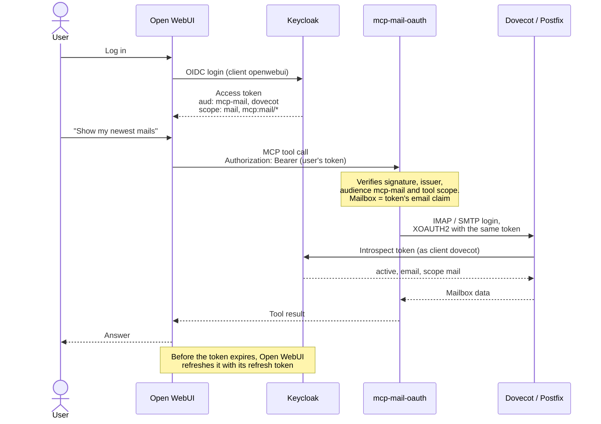
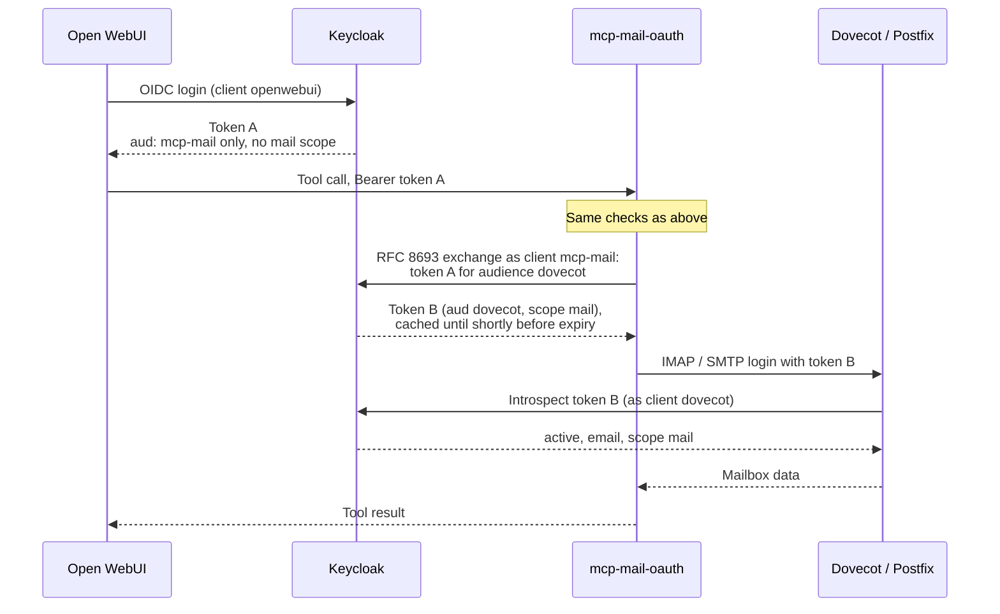

# mcp-mail-oauth

An MCP server that lets an AI assistant read and send the **signed-in user's
own mail** on an IMAP/SMTP server that accepts OAuth tokens (XOAUTH2 /
OAUTHBEARER), using **the user's existing login**: no extra authorization
step, no stored passwords, no per-user state on the server.

Built for Open WebUI + Keycloak + Dovecot/Postfix. The server supports two
variants for the credential it presents to the mail server. Everything else,
including the Open WebUI, Dovecot and Postfix configuration, is identical.
Details, a decision chart and the Keycloak layouts:
**[docs/mail-credential.md](docs/mail-credential.md)**.

### Forwarded token (default, `MAIL_TOKEN_EXCHANGE=off`)



1. The user logs in to Open WebUI with Keycloak.
2. Open WebUI's MCP auth type **"OAuth"** forwards that user's access token.
3. mcp-mail-oauth verifies it (signature, issuer, audience `mcp-mail`,
   per-tool scope) and takes the mailbox name from its `email` claim.
4. It logs in to Dovecot/Postfix with **the same token**. Dovecot checks it by
   introspection against Keycloak (active, audience `dovecot`, scope `mail`).

Two Keycloak clients: Open WebUI's and `dovecot`.

### Token exchange (`MAIL_TOKEN_EXCHANGE=on`)



Steps 1 to 3 are the same. In step 4 the server presents a **separate token**
that Keycloak issued to it for the mail server. Token A alone is refused by
Dovecot. This conforms to the MCP spec's no-pass-through rule. It needs a
third Keycloak client (`mcp-mail`) and Keycloak 26.2+.

## Why it's built this way

The predecessor project needed **four Keycloak clients**, a second OAuth
flow per user with a manual "authorize mail" click, and an in-memory token
cache that was lost on every restart. Reusing the token the user already has
removes all of that: **two clients** (Open WebUI's, which exists anyway, and
Dovecot's introspection credentials), no extra click, no server-side state.
The reasoning behind every choice, including the trade-offs, is in
**[docs/decisions.md](docs/decisions.md)**. Start with D2.

Reusing the token is, strictly, the "token pass-through" the MCP
authorization spec forbids. The default does it deliberately (D4); token
exchange is the conforming alternative (D23). How to choose:
[docs/mail-credential.md](docs/mail-credential.md).

## Tools

| Tool | Needs scope | What it does |
|---|---|---|
| `whoami` | none | Who you are, which mailbox, which scopes are missing |
| `list_folders` | `mcp:mail/read` | Folders and their flags |
| `list_messages` | `mcp:mail/read` | Newest first, paged, optionally unread only |
| `search_messages` | `mcp:mail/read` | By sender, recipient, subject, text, date range, unread |
| `read_message` | `mcp:mail/read` | Headers, text body, attachment list. Fetches only the text part, never attachments. Doesn't mark as read by default |
| `get_message_info` | `mcp:mail/read` | Headers, flags, size, attachment names/types/sizes; no body |
| `get_thread` | `mcp:mail/read` | The conversation around a message, from the folder and Sent, oldest first |
| `get_attachment` | `mcp:mail/read` | One attachment: text, HTML, PDF text, attached emails, images |
| `folder_status` | `mcp:mail/read` | Message and unread counts per folder |
| `send_message` | `mcp:mail/send` | Plain-text mail from your own address; reply / reply-all with threading; copy saved to Sent |
| `forward_message` | `mcp:mail/send` | Forwards a message unchanged, attachments included, with your comment |
| `save_draft` | `mcp:mail/draft` | Saves a mail (or reply) to Drafts without sending it |
| `set_flags` | `mcp:mail/organize` | Read/unread, flagged/unflagged |
| `move_messages` | `mcp:mail/organize` | To another folder, e.g. Archive |
| `trash_messages` | `mcp:mail/organize` | To Trash; nothing is deleted permanently |

Tools whose scope is missing from the token are hidden, and `whoami` tells
you which ones.

## Setup

**Adding it to an existing Open WebUI + Keycloak + Dovecot/Postfix
setup: follow [docs/integration.md](docs/integration.md)**, the step-by-step
walkthrough with a check after each step. In short:

0. **Pick the mail credential**: forwarded token (default) or token exchange
   ([docs/mail-credential.md](docs/mail-credential.md)). Only steps 1 and 3
   differ between them.
1. **Keycloak**: client scopes, audience mappers, Dovecot's introspection
   client. One script does it, `setup-kcadm.sh` (forwarded token) or
   `setup-kcadm.sh --exchange` (token exchange): [docs/keycloak.md](docs/keycloak.md).
2. **Dovecot + Postfix**: oauth2 passdb with introspection; Postfix SASL via
   Dovecot. See [docs/mail-server.md](docs/mail-server.md).
3. **This server**:
   ```bash
   cp .env.example .env    # set OIDC_ISSUER, BASE_URL, MAIL_* hosts
                           # token exchange: also MAIL_TOKEN_EXCHANGE=on, OIDC_CLIENT_ID/SECRET
   docker compose up -d
   ```
4. **Open WebUI**: SSO with `offline_access`, then add this server as an MCP
   tool server with auth type "OAuth". See [docs/open-webui.md](docs/open-webui.md).
5. **Check**: ask the assistant to run `whoami`, or run
   [`mcp-mail-diagnose`](docs/troubleshooting.md) against a token.

Behind Traefik or another reverse proxy, also under a sub-directory such as
`/mcp/mail-oauth/`: see [docs/reverse-proxy.md](docs/reverse-proxy.md).

Other MCP clients (Claude Desktop, MCP Inspector) can't forward a Keycloak
token. They need `AUTH_MODE=proxy`; see [docs/keycloak.md](docs/keycloak.md#proxy-mode).
`AUTH_MODE` is independent of the mail credential: it decides how clients
log in to this server, not what the server presents to the mail server.

## Releases

Every push to `main` that passes the tests, the end-to-end checks against a
real Keycloak/Postfix/Dovecot stack, both Trivy scans and a container smoke
test publishes a new image and tag `vX.Y.Z`. The version is bumped
automatically from commit messages (`feat:` → minor, `!`/`BREAKING CHANGE` →
major, else patch). See [docs/ci.md](docs/ci.md).

## Development

```bash
python3 -m venv .venv && .venv/bin/pip install -e ".[dev]"
.venv/bin/pytest
```

The tests need no Keycloak or mail server. Tokens are signed with a local
key, and the HTTP tests run the real FastMCP auth stack end to end, with only
the IMAP/SMTP calls replaced.

For the real thing, [`test-stack/`](test-stack/README.md) runs Keycloak,
Postfix, Dovecot and this server in Docker, configured with the files from
`deploy/`, plus end-to-end checks (also a CI gate):

```bash
docker compose -f test-stack/docker-compose.yml up -d --build
docker compose -f test-stack/docker-compose.yml run --rm e2e
docker compose -f test-stack/docker-compose.yml down -v
```

| Path | Contents |
|---|---|
| `src/mcp_mail/auth.py` | Which tokens are accepted (resource/proxy mode) |
| `src/mcp_mail/mail.py` | IMAP/SMTP with XOAUTH2/OAUTHBEARER, parsing, sending |
| `src/mcp_mail/server.py` | The MCP tools |
| `src/mcp_mail/diagnose.py` | `mcp-mail-diagnose` |
| `scripts/next_version.py` | Next release version from tags + commits |
| `.github/workflows/ci.yml` | Tests, Trivy, build, release |
| `deploy/` | Keycloak script, Dovecot 2.3/2.4 and Postfix snippets, Open WebUI env |
| `test-stack/` | Disposable Keycloak + Postfix/Dovecot stack, end-to-end checks |
| `docs/` | Decisions, setup guides, troubleshooting |
