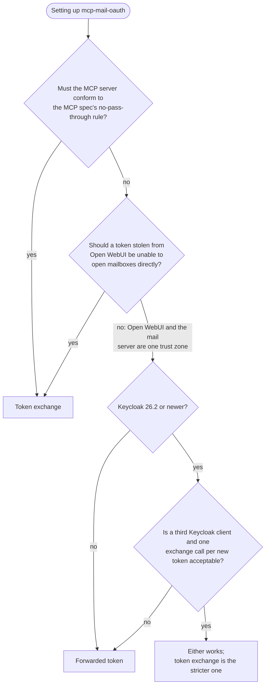
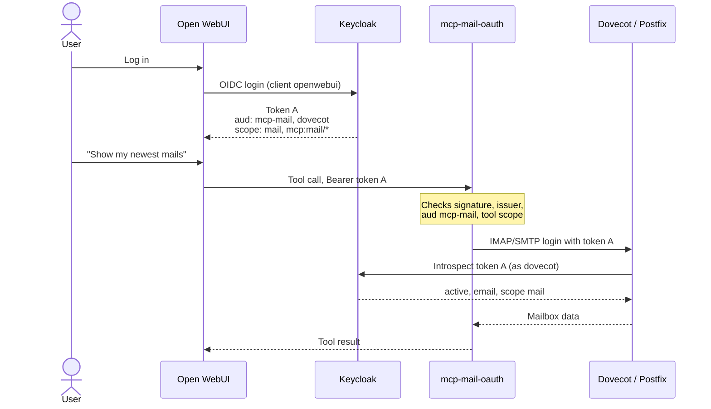
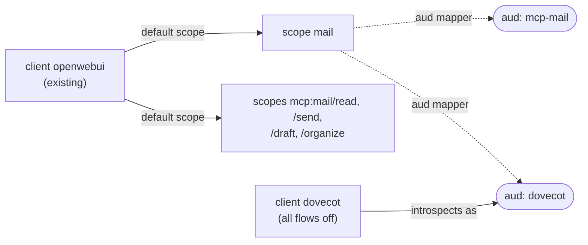
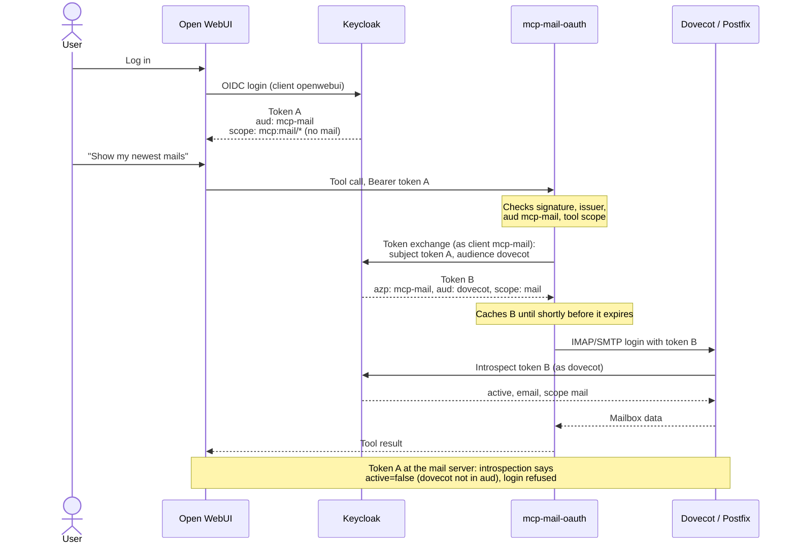
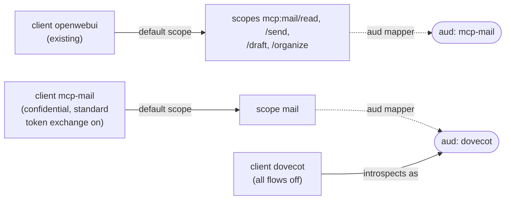

# Mail credential: forwarded token or token exchange

The server logs in to IMAP/SMTP with an OAuth token. Which token is the one
choice that differs between the two supported setups:

| | **Forwarded token** (default) | **Token exchange** |
|---|---|---|
| Setting | `MAIL_TOKEN_EXCHANGE=off` | `MAIL_TOKEN_EXCHANGE=on` |
| Mail server receives | the token Open WebUI sent | a separate token the server obtains from Keycloak (RFC 8693) |
| Keycloak clients | 2: Open WebUI's, `dovecot` | 3: Open WebUI's, `dovecot`, `mcp-mail` |
| Open WebUI's token | `aud` mcp-mail **and dovecot**, scope `mail` | `aud` mcp-mail only, **no** `mail` scope |
| A leaked Open WebUI token | also opens the mailbox (for its lifetime) | is refused by the mail server |
| MCP spec "no token pass-through" | deliberate deviation ([D4](decisions.md#d4-audience-binding-mcp_audience-a-custom-audience-string)) | conforms |
| Keycloak version | any recent | 26.2+ |
| Dovecot, Postfix, Open WebUI config | identical | identical |

Reasons: [decisions.md](decisions.md) D2 (forwarded) and D23 (exchange).

**Not to be confused with `AUTH_MODE`.** `AUTH_MODE` (`resource` / `proxy`)
decides how clients authenticate **to this server**. The mail credential
decides what this server presents **to the mail server**. The two are
independent: all four combinations work. Open WebUI with auth type "OAuth"
needs only `AUTH_MODE=resource`.

The container's startup log names the active variant
(`... mail credential=forwarded token ...`), and so does the `whoami` tool
(`mail_credential`).

## Which one?



## Forwarded token (default)



Keycloak layout:



Setup: `setup-kcadm.sh` without flags ([keycloak.md](keycloak.md)). Server
settings: nothing beyond the basics in `.env.example`.

Token check (*Clients → openwebui → Client scopes → Evaluate → Generated
access token*):

```json
"aud": ["mcp-mail", "dovecot"],
"scope": "openid email profile mail mcp:mail/read mcp:mail/send mcp:mail/draft mcp:mail/organize"
```

## Token exchange



Keycloak layout:



Setup: `setup-kcadm.sh --exchange` ([keycloak.md](keycloak.md)). It prints
the `mcp-mail` client secret. Server settings:

```
MAIL_TOKEN_EXCHANGE=on
OIDC_CLIENT_ID=mcp-mail              # must equal MCP_AUDIENCE (checked at startup)
OIDC_CLIENT_SECRET=<printed by the script>
#OIDC_TOKEN_ENDPOINT=http://keycloak:8080/realms/<realm>/protocol/openid-connect/token
                                     # only if the public issuer isn't reachable (like OIDC_JWKS_URI)
#MAIL_TOKEN_AUDIENCE=dovecot          # Dovecot's introspection client
```

Token check (same place as above), for Open WebUI's token:

```json
"aud": "mcp-mail",
"scope": "openid email profile mcp:mail/read mcp:mail/send mcp:mail/draft mcp:mail/organize"
```

No `dovecot`, no `mail`: that's the point. `mcp-mail-diagnose
--introspect-client-id dovecot --imap` shows the exchange and then logs in
with the exchanged token.

## Switching

Forwarded token → token exchange:
1. `setup-kcadm.sh --exchange`. This removes `mail` from Open WebUI's client
   and sets up `mcp-mail`.
2. Set the three server variables above and restart the container.
3. Users log in to Open WebUI again, so their tokens lose `mail`/`dovecot`.
   Until then the old tokens still work, because they can be exchanged too.

Token exchange → forwarded token:
1. `setup-kcadm.sh` without `--exchange` puts `mail` back on Open WebUI's
   client.
2. `MAIL_TOKEN_EXCHANGE=off` and restart. Users log in again.
3. Optionally delete the `mcp-mail` client, unless `AUTH_MODE=proxy` uses it.

Both variants are tested end to end on every CI run (test stack,
`MAIL_TOKEN_EXCHANGE=off|on`).
