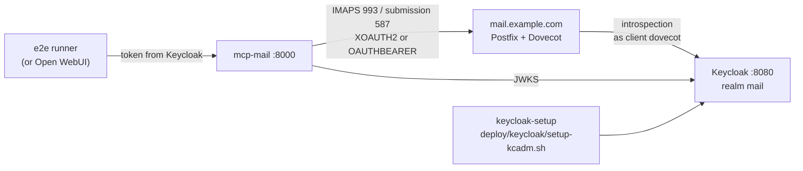

# Disposable test stack

Keycloak, Postfix + Dovecot (OAuth) and mcp-mail-oauth in Docker, configured
with the files from [`deploy/`](../deploy), plus end-to-end checks of the
whole chain. Use it to try the setup, to compare against your own
configuration, or to reproduce a problem. CI runs the same checks before
every release (Dovecot 2.3 and 2.4).

```bash
docker compose -f test-stack/docker-compose.yml up -d --build
docker compose -f test-stack/docker-compose.yml run --rm e2e     # 22 checks (25 with token exchange)
docker compose -f test-stack/docker-compose.yml down -v          # removes everything
```

`run --rm e2e` also starts the stack if it isn't up yet.



## What gets started

| Service | What it is |
|---|---|
| `init` | Generates a throwaway CA, a certificate for `mail.example.com`, and the realm to import |
| `keycloak` | Keycloak 26.8.1, dev mode, realm `mail` with users `alice`/`alice` and `bob`/`bob` |
| `keycloak-setup` | Runs [`deploy/keycloak/setup-kcadm.sh`](../deploy/keycloak/setup-kcadm.sh) against that realm, twice (the second run must change nothing) |
| `mail` | Debian with Postfix and Dovecot, configured from `deploy/dovecot` and `deploy/postfix` with only the placeholders filled in |
| `mcp-mail` | This server, built from the working tree |
| `e2e` | [`e2e.py`](e2e.py), run on demand |
| `open-webui` | Optional (`--profile webui`), see below |

The imported realm is deliberately incomplete, a stand-in for an existing
realm: Open WebUI's client and two users, nothing for mail. Everything
mail-related is created by the setup script, the same way as in
[docs/keycloak.md](../docs/keycloak.md) option A.

## Token exchange

```bash
MAIL_TOKEN_EXCHANGE=on docker compose -f test-stack/docker-compose.yml up -d --build
MAIL_TOKEN_EXCHANGE=on docker compose -f test-stack/docker-compose.yml run --rm e2e
```

Runs `setup-kcadm.sh --exchange` and the server with separate mail tokens
([decisions.md](../docs/decisions.md) D23). The e2e run adds three checks:
- Open WebUI's token is inactive for Dovecot and refused at IMAP.
- The exchanged token is issued to `mcp-mail`, for `dovecot`, with scope
  `mail`, for the same user.

All other checks then use the exchanged token. Run `down -v` when switching
modes.

## Dovecot version

```bash
DOVECOT=2.4 docker compose -f test-stack/docker-compose.yml up -d --build
```

| `DOVECOT` | Dovecot | Postfix | Base | Expected result |
|---|---|---|---|---|
| `2.3` (default) | 2.3.21.1 | 3.10.3 | Debian 12 + backports | all checks pass |
| `2.4` | 2.4.1 | 3.10.13 | Debian 13 | all checks pass |
| `2.3.19` | 2.3.19.1 | 3.7 | Debian 12 | fails at the IMAP login: "No username returned" ([why](../docs/mail-server.md#versions)) |

When switching versions, run `down -v` first.

## What the checks cover

In order; the first failure stops the run and names the failing link:

1. Keycloak issues alice a token with `mcp-mail` and `dovecot` in `aud` and
   the mail scopes (created by the setup script).
2. The MCP server accepts it and lists all six tools. `whoami` maps it to
   `alice@example.com`.
3. Keycloak's introspection, asked as the `dovecot` client, says
   `active: true` and returns `email`.
4. IMAP login with the forwarded token, XOAUTH2.
5. `send_message` to bob: SMTP AUTH through Postfix → Dovecot, then the Sent
   copy.
6. bob finds and reads the message (LMTP delivery). It isn't in alice's
   INBOX, but it is in her Sent folder.
7. IMAP and SMTP with OAUTHBEARER.
8. Postfix refuses a forged sender (`reject_sender_login_mismatch`).
9. After alice logs out, Dovecot rejects her still-unexpired token
   (`force_introspection`, `active_attribute`).
10. The MCP server answers 401 to a missing or tampered token.

## Trying it with Open WebUI

```bash
docker compose -f test-stack/docker-compose.yml --profile webui up -d --build
```

1. Open http://localhost:3000, *Continue with Keycloak*, log in as `alice` /
   `alice`. (The first account becomes the Open WebUI admin.)
2. *Admin Panel → Settings → External Tools → +*: type **MCP (Streamable
   HTTP)**, URL `http://mcp-mail:8000/mcp`, auth **OAuth**.
3. Tool calls need a model; connect one under *Admin Panel → Settings →
   Connections*.

The CI runs don't include this part, so it's untested.

Keycloak's admin console is at http://localhost:8080 (`admin` / `admin`).
IMAP and submission are published on `127.0.0.1:1993` and `127.0.0.1:1587`
for a mail client. They need the CA from the `certs` volume, and the name
`mail.example.com` mapped to `127.0.0.1`.

## Test-only shortcuts

None of these belong in a real deployment:
- **Password grant on `openwebui`:** the `openwebui` client allows the
  password grant, so `e2e.py` gets tokens without a browser.
- **Fixed secrets:** `openwebui-test-secret`, `dovecot-test-secret`, and
  `admin`/`admin`.
- **Throwaway CA:** a CA created on first start, valid for 30 days.
- **Plain HTTP:** Keycloak is reached over plain HTTP, inside the Docker
  network and on 127.0.0.1.
- **Container-friendly mail setup:**
  - Postfix without chroot.
  - Dovecot with a static userdb that accepts any user.
  - Postfix accepting any local recipient.
- **Root:** the mail container's processes start as root (Postfix and
  Dovecot drop privileges themselves).

## Ports

All bound to 127.0.0.1. Override with these variables when a port is taken:

| Variable | Default | Service |
|---|---|---|
| `KEYCLOAK_PORT` | 8080 | Keycloak (also the token issuer: `http://localhost:<port>/realms/mail`) |
| `MCP_PORT` | 8000 | mcp-mail |
| `IMAPS_PORT` | 1993 | Dovecot IMAPS |
| `SUBMISSION_PORT` | 1587 | Postfix submission |
| `WEBUI_PORT` | 3000 | Open WebUI. The realm's redirect URI is fixed to port 3000 |
